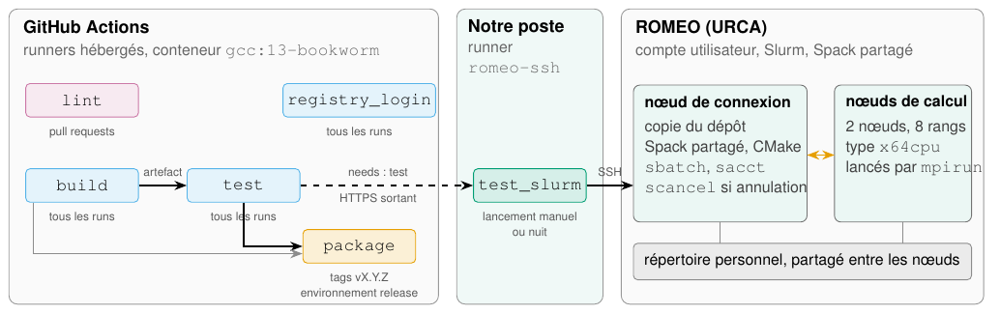
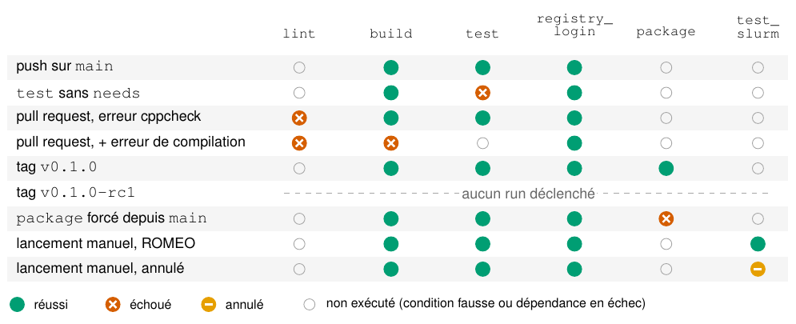
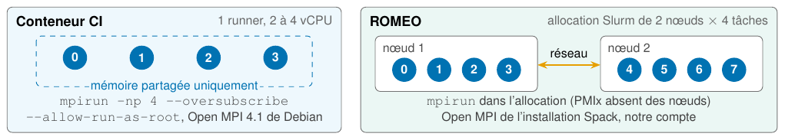
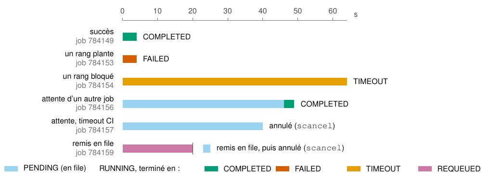
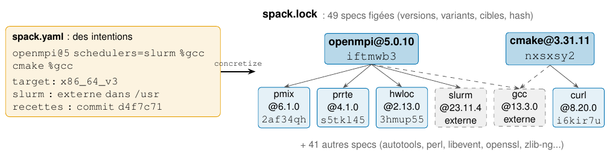

# Carnet de bord : DevOps pour le HPC (Cours 6, séance en pédagogie inversée)

Sylvain ROWE, M2 CHPS, UE CHPS0902. Dépôt : <https://github.com/orrnithogalum/mpiflow>, tag `seance-inversee`. Version mise en page : `carnet-de-bord.pdf`.

# 1 Introduction

Un code de calcul ne vit pas seulement sur le poste du développeur : il est compilé, testé, empaqueté, puis exécuté sur un cluster partagé où tout passe par l’ordonnanceur Slurm et où l’environnement logiciel doit être identique sur chaque nœud. Le DevOps automatise cette chaîne, mais ses outils ne se transposent pas tels quels du cloud au HPC : selon la formule du cours, « CI ≠ exécution cluster ».

Cette séance en pédagogie inversée consistait à le vérifier par l’expérience, en quatre missions : faire compiler et tester un code MPI par une autre machine (mission 1), conditionner les jobs à des événements et protéger un secret (mission 2), faire franchir au pipeline la frontière entre le runner CI et Slurm (mission 3), et versionner l’environnement logiciel avec Spack (mission 4). Ce carnet de bord constitue la mission 5. Pour chaque mission, il présente la réalisation et ses preuves d’exécution, répond aux questions de cadrage, décrit les erreurs rencontrées et se termine par un bilan en trois lignes ; un auto-diagnostic conclut.

# 2 Matériels et méthodes

Nous avons choisi GitHub Actions, que le sujet autorise. Les jobs des missions 1 et 2 tournent sur les runners hébergés par GitHub (Ubuntu 24.04), dans le conteneur `gcc:13-bookworm` demandé. Le fichier `.gitlab-ci.yml` équivalent est fourni dans le dépôt et a été validé localement avec l’émulateur `gitlab-ci-local` ; les questions de cadrage, écrites pour GitLab, sont traitées pour les deux plateformes.

Pour la mission 3, nous utilisons le supercalculateur ROMEO de l’URCA, que le sujet propose comme alternative au cluster GCP (Red Hat Enterprise Linux 9.6 (Plow), Slurm 23.11.10-BullSequana.1.0, partition\
textttshort, nœuds\
textttx64cpu). Nous y disposons d’un compte ordinaire : pas de droits d’administration, une file d’attente partagée avec les autres utilisateurs, un projet Slurm auquel les heures sont imputées, et des logiciels fournis par une installation Spack partagée plutôt que par des modules. Le job `test_slurm` y accède par SSH, depuis un runner GitHub auto-hébergé qui tourne sur notre poste (figure 1).

*Figure 1. Pipeline et infrastructure. Les jobs des missions 1 et 2 tournent sur les runners de GitHub ; `test_slurm` (mission 3) est exécuté par le runner auto-hébergé de notre poste, qui interroge GitHub en HTTPS et pilote ROMEO par SSH. Sous chaque job figure la condition qui le crée ; les flèches pleines entre jobs sont les dépendances `needs`.*

La figure 1 montre la séparation des rôles : les runners de GitHub compilent et testent dans un conteneur ; le runner de notre poste ne fait qu’orchestrer, en copiant le dépôt sur ROMEO puis en y lançant la compilation et la soumission par SSH ; le calcul a lieu sur les nœuds alloués par Slurm. Le répertoire personnel, partagé entre le nœud de connexion et les nœuds de calcul, porte le binaire compilé et les sorties des jobs.

Pour pouvoir casser les choses librement (faire échouer un test, saturer la file, tuer un nœud), ce qu’un centre de production ne permet pas, chaque mission a d’abord été reproduite sur un poste Linux, avec un mini-cluster Slurm complet dont nous étions administrateurs, puis rejouée sur GitHub et sur ROMEO. Les preuves sont collectées par des scripts : `scripts/github_evidence.py` pilote GitHub avec la CLI `gh`, `romeo/romeo.sh` rejoue les scénarios sur ROMEO par SSH. Chaque commande, sa sortie et son code retour sont écrits dans `logs/`, et les listings de ce document incluent ces fichiers tels quels.

# 3 Mission 1 : un pipeline minimal

## 3.1 Réalisation et preuves

Le test `tests/test_mpi.c` vérifie que la valeur diffusée par `MPI_Bcast` arrive sur tous les rangs, que tous participent à un `MPI_Allreduce` et, si la variable `EXPECTED_RANKS` est définie, que `MPI_COMM_WORLD` a bien cette taille ; le rang 0 affiche le nœud de chaque rang. Les vérifications renvoient un code d’erreur au lieu d’utiliser `assert`, pour une raison donnée en section 3.3. CTest déclare deux tests, à 1 et 4 rangs.

Le workflow (listing 1) enchaîne deux jobs dans l’image `gcc:13-bookworm`, où CMake et Open MPI sont installés par `apt`. L’image remplace le `gfortran` de Debian par le sien (`dpkg-divert` de `/usr/bin/gfortran` vers `/usr/local/bin`) : le paquet `gfortran`, tiré par `libopenmpi-dev`, échoue alors à sa configuration (`update-alternatives: alternative path /usr/bin/gfortran doesn't exist`) et tous les runs cassaient dès `apt-get` ; un lien symbolique posé avant l’installation suffit. Le job `build` archive `build/` avec `tar`, car `upload-artifact` ne conserve pas le bit d’exécution, et le publie comme artefact ; le job `test`, relié par `needs: build`, le télécharge, lance `ctest` puis `mpirun -np 4 --allow-run-as-root --oversubscribe`.

      # ===================================================== Mission 1 =============
      build:
        runs-on: ubuntu-24.04
        container: gcc:13-bookworm
          # l'image détourne /usr/bin/gfortran (dpkg-divert) : sans ce lien vers le sien,
          # le paquet gfortran tiré par libopenmpi-dev échoue (update-alternatives)
          - run: |
              ln -sf /usr/local/bin/gfortran /usr/bin/gfortran
              apt-get update -qq && apt-get install -y -qq cmake libopenmpi-dev openmpi-bin > /dev/null
          - run: |
              cmake -B build -DCMAKE_BUILD_TYPE=Release -DMPIEXEC_PREFLAGS="--allow-run-as-root;--oversubscribe"
              cmake --build build -j"$(nproc)"
          # upload-artifact ne conserve pas les permissions (bit x perdu) : archive tar
          - run: tar -cf build.tar build
          - uses: actions/upload-artifact@v7
            with:
              name: build
              path: build.tar

      test:
        container: gcc:13-bookworm
          - run: |                         # lien gfortran : voir le job build
              ln -sf /usr/local/bin/gfortran /usr/bin/gfortran
              apt-get update -qq && apt-get install -y -qq cmake libopenmpi-dev openmpi-bin > /dev/null
          - uses: actions/download-artifact@v8
            with:
              name: build
          - run: tar -xf build.tar
          - run: cd build && ctest --output-on-failure

*Listing 1. Jobs `build` et `test`, extrait du workflow (`.github/workflows/ci.yml`)*

Sur `main`, le run réussit (listing 2) : les deux tests CTest passent et le test MPI affiche `4 ranks on 1 host(s)`.

    Run https://github.com/orrnithogalum/mpiflow/actions/runs/40208605871
    (push sur main, commit daf94f0) : success
      jobs exécutés : build success, test success, registry_login success
      jobs ignorés  : lint, package, test_slurm

    --- job test (extrait) ---
    1/2 Test #1: mpi_bcast_np1 ....................   Passed    0.30 sec
    2/2 Test #2: mpi_bcast_np4 ....................   Passed    0.34 sec
    100% tests passed, 0 tests failed out of 2
      rangs 0 à 3 sur 802cbc5d2e66   [4 lignes regroupées]
    MPI test passed with 4 ranks on 1 host(s)

    --- job registry_login ---
    > Run echo "ref=${GITHUB_REF} événement=${GITHUB_EVENT_NAME}"
    ref=refs/heads/main événement=push
    FAKE_REGISTRY_TOKEN vide : secret non transmis à ce job

*Listing 2. Run du workflow sur `main` (`logs/extraits/github-m1-main.txt`)*

généré par scripts/figures.py : ne pas modifier à la main

*Figure 2. Jobs exécutés selon l’événement déclencheur, d’après les runs GitHub Actions du dépôt (`logs/github/runs.json`). Une ligne par run ; `test_slurm` tourne sur le runner auto-hébergé `romeo-ssh`, qui soumet sur ROMEO, les autres jobs sur les runners de GitHub.*

La figure 2 récapitule les runs des missions 1 à 3, une ligne par événement déclencheur. Sur `main`, seuls `build`, `test` et `registry_login` sont créés ; `lint` n’existe que pour une pull request, `package` que pour un tag de version, et `test_slurm` que pour un lancement manuel ou planifié. Les questions qui suivent renvoient aux lignes de cette figure.

## 3.2 Questions de cadrage

### 3.2.1 Deux jobs d’un même stage échouent : le pipeline continue-t-il, et pourquoi est-ce souhaitable ?

Les jobs d’un même stage sont indépendants : chacun va au bout, mais le stage suivant ne démarre pas. Nous l’avons vérifié avec l’émulateur de GitLab, sur trois builds parallèles dont deux échouent : le second échec arrive deux secondes après le premier, le stage `test` n’est jamais lancé et seul un job déclaré `when: on_failure` s’exécute (`logs/m1-stage-fail.txt`). GitHub Actions n’a pas de stages, mais des jobs sans dépendance entre eux jouent le même rôle. Sur la pull request où `lint` et `build` échouent ensemble (figure 2, quatrième ligne), les deux vont au bout, `registry_login` aussi, et `test`, qui dépend de `build`, n’est pas exécuté. Seules des exceptions explicites lèvent ce blocage : `allow_failure` ou `when: always` sur GitLab, `continue-on-error` ou `if: always()` sur GitHub.

Ce comportement est souhaitable parce qu’il fait échouer tôt : tester ou empaqueter un binaire qui n’a pas compilé n’a pas de sens, et en HPC l’étape suivante coûte de l’attente en file et des heures de calcul. Il empêche aussi de publier un artefact non validé, ce qui explique que `package` dépende de `build` et de `test`, et non de `build` seul. Enfin, laisser aller au bout les jobs indépendants rassemble toutes les causes d’échec, ici l’analyse statique et la compilation, dans un seul run.

### 3.2.2 Quelle différence entre mpirun dans le conteneur CI et une exécution sur le cluster ?

Dans le conteneur, le test affiche `4 ranks on 1 host(s)` ; sur ROMEO, huit rangs se répartissent sur deux nœuds (section 5.2). La figure 3 représente ce qui sépare les deux exécutions.

*Figure 3. Le même test MPI dans le conteneur CI et sur le cluster : placement des rangs, communications et lanceur.*

Dans le conteneur, les quatre rangs partagent une machine de quelques vCPU : il faut `--oversubscribe` pour lancer plus de rangs que de cœurs et `--allow-run-as-root` parce que le conteneur tourne en root. Les communications ne passent que par la mémoire partagée, et `mpirun` crée lui-même les processus, sans allocation. Sur ROMEO, les rangs démarrent dans une allocation Slurm, sous notre compte sans privilèges et avec l’Open MPI de l’installation Spack du centre. Faute de bibliothèque PMIx sur les nœuds de calcul, `srun` ne peut pas les lancer lui-même : `mpirun` s’appuie sur l’allocation et démarre un démon par nœud avec Slurm (étape `prted` de `sacct`). Les rangs de nœuds différents communiquent par le réseau d’interconnexion.

Les deux exécutions réagissent aussi différemment aux pannes : quand un rang meurt, `mpirun` arrête tout le job, alors que `srun` peut laisser les autres rangs bloqués dans une collective jusqu’au wall-time (mission 3). On en déduit que le CI valide la logique du code sur peu de rangs à chaque push, comme un test unitaire, tandis que seul le cluster valide l’intégration du code, du MPI, du lanceur et du réseau, et produit des temps qui ont un sens. Le binaire du conteneur, lié à l’Open MPI de Debian, n’est d’ailleurs pas réutilisé : le job de ROMEO recompile.

### 3.2.3 Pourquoi le test échoue-t-il si l’on oublie needs, alors que le build a réussi ?

Chaque job démarre dans un environnement neuf. Sur GitHub, `test` reçoit une nouvelle VM et un nouveau conteneur, sans le répertoire `build/` du job précédent. Sans `needs`, GitHub le lance en même temps que `build`, sur une autre machine : quand il demande l’artefact, celui-ci n’existe pas encore, et le téléchargement échoue alors que le build réussit (figure 2, deuxième ligne, et listing 3). `needs` impose l’ordre d’exécution et garantit que l’artefact est publié avant d’être demandé.

    Run https://github.com/orrnithogalum/mpiflow/actions/runs/40208780629
    (workflow_dispatch, test sans needs, commit 8acb4e9) : failure
      jobs exécutés : build success, test failure, registry_login success
      jobs ignorés  : lint, package, test_slurm

    --- job test ---
    Download action repository 'actions/download-artifact@v8' (SHA:9000827ccba6bdab643e8b6fd33ac0654aef8333)
    > Run actions/download-artifact@v8
    Downloading single artifact
    Error: Unable to download artifact(s): Artifact not found for name: build
            Please ensure that your artifact is not expired and the artifact was uploaded using a compatible version of toolkit/upload-artifact.
            For more information, visit the GitHub Artifacts FAQ: https://github.com/actions/toolkit/blob/main/packages/artifact/docs/faq.md
      [failure] Unable to download artifact(s): Artifact not found for name: build
            Please ensure that your artifact is not expired and the artifact was uploaded using a compatible version of toolkit/upload-artifact.
            For more information, visit the GitHub Artifacts FAQ: https://github.com/actions/toolkit/blob/main/packages/artifact/docs/faq.md

*Listing 3. Job `test` lancé sans `needs` (`logs/extraits/github-m1-sans-needs.txt`)*

Sur GitLab, l’expérience nous a obligés à nuancer : supprimer `needs` ne fait pas échouer le test, car les stages imposent déjà l’ordre et un job télécharge par défaut les artefacts de tous les stages précédents (`logs/m1-needs.txt`). Le test n’y échoue que s’il démarre sans attendre, avec `needs: []`, ou s’il est placé dans le même stage que le build. `needs` sert alors à démarrer plus tôt et à ne télécharger que les artefacts utiles.

## 3.3 Erreurs rencontrées et résolution

Lancé en root sur 2 cœurs, `mpirun` a d’abord refusé de démarrer en root, puis faute d’emplacements pour 4 rangs ; les deux options demandées par le sujet lèvent ces refus, et la variable CMake `MPIEXEC_PREFLAGS` les transmet à CTest.

Le test MPI des diapositives, fondé sur `assert`, passait même avec un bug volontaire. En `Release`, CMake ajoute `-DNDEBUG`, qui supprime les `assert` (listing 4). Notre test vérifie explicitement chaque résultat et renvoie un code d’erreur.

    $ mpicc -O2 -o dbg slide_test_mpi_bug.c && mpirun --allow-run-as-root --oversubscribe --tag-output -np 2 ./dbg 2>&1 | grep -E 'Assertion|passed|exited'
    [1,1]<stderr>:dbg: slide_test_mpi_bug.c:12: main: Assertion `data == 42' failed.
    [1,1]<stderr>:[vm:02657] [1,1]<stderr>:[ 0] [1,0]<stderr>:dbg: slide_test_mpi_bug.c:12: main: Assertion `data == 42' failed.
    mpirun noticed that process rank 1 with PID 0 on node vm exited on signal 6 (Aborted).
    [code retour : 134]
    $ mpicc -O3 -DNDEBUG -o rel slide_test_mpi_bug.c && mpirun --allow-run-as-root --oversubscribe -np 2 ./rel
    MPI test passed with 2 ranks
    [code retour : 0]

*Listing 4. Test des diapositives avec un bug volontaire, sans puis avec `-DNDEBUG` (`logs/m1-ndebug.txt`)*

## 3.4 Bilan

Le pipeline `build` puis `test` tourne sur GitHub à chaque push sur `main` et sur chaque pull request, avec un test MPI capable d’échouer. Il ne teste cependant que quatre rangs sur une seule machine, en surréservation, et ne dit rien des performances. Nous écririons d’abord un test qui échoue volontairement avant de lui faire confiance : c’est ce qui a révélé le piège de `NDEBUG`.

# 4 Mission 2 : déclencheurs, règles et secrets

## 4.1 Réalisation et preuves

Trois jobs s’ajoutent au pipeline (listing 5). Le job `lint` lance `cppcheck` avec `--error-exitcode=1` et n’existe que pour l’événement `pull_request`. Le job `package` ne se déclenche que sur un tag `vX.Y.Z` ; il archive le binaire, le README et un fichier `BUILDINFO.txt` (tag, commit, URL du run), calcule le SHA-256 de l’archive et simule la publication avec `scripts/fake_docker_login.sh`, qui reproduit le contrat de `docker login --password-stdin` sans démon Docker. Le secret `FAKE_REGISTRY_TOKEN`, une fausse valeur, est rangé dans l’environnement `release`, que GitHub n’ouvre qu’aux tags `v*`. Le job `registry_login`, qui ne déclare pas d’environnement, montre ce qu’un job ordinaire voit du secret.

    on:
      push:
        branches: [main]
        tags: ['v[0-9]+.[0-9]+.[0-9]+']    # vX.Y.Z seulement : v1.2.3-rc1 ne déclenche rien
      pull_request:
      # ===================================================== Mission 2 : package ===
      package:
        needs: [build, test]
        if: startsWith(github.ref, 'refs/tags/v') || inputs.publier
        runs-on: ubuntu-24.04
        environment: release               # secret protégé : uniquement pour les tags v*
        env:
          TAG: ${{ github.ref_name }}

*Listing 5. Déclencheurs et en-tête du job `package`, extrait du workflow (`.github/workflows/ci.yml`)*

La figure 2 montre l’effet des règles. Le commit de la pull request ne crée qu’un run, où `lint` échoue sur l’écriture hors du tableau ajoutée volontairement (listing 6). Le tag `v0.1.0` déclenche `package`, qui produit l’archive et sa somme de contrôle ; son log n’affiche le secret que sous la forme `***` (listing 7). Le tag `v0.1.0-rc1` ne déclenche aucun run (`logs/github/m2-rc1.txt`).

    Pull request https://github.com/orrnithogalum/mpiflow/pull/5
    runs créés pour le commit 8c743b2 : 1 (pull_request)
    Run https://github.com/orrnithogalum/mpiflow/actions/runs/40208862294
    (pull_request, commit 8c743b2) : failure
      jobs exécutés : lint failure, build success, test success, registry_login success
      jobs ignorés  : package, test_slurm

    --- job lint ---
    > Checking out the ref
    > Run sudo apt-get update -qq && sudo apt-get install -y -qq cppcheck
    Selecting previously unselected package cppcheck.
    Preparing to unpack .../cppcheck_2.13.0-2ubuntu3_amd64.deb ...
    Unpacking cppcheck (2.13.0-2ubuntu3) ...
    Setting up cppcheck (2.13.0-2ubuntu3) ...
    > Run cppcheck --enable=warning,style,performance,portability --std=c11 --error-exitcode=1 --inline-suppr --suppress=missingIncludeSystem tests/
    Checking tests/test_mpi.c ...
    tests/test_mpi.c:31:8: error: Array 'tab[4]' accessed at index 4, which is out of bounds. [arrayIndexOutOfBounds]
        tab[4] = rank; /* erreur volontaire */
    tests/test_mpi.c:31:12: style: Variable 'tab[4]' is assigned a value that is never used. [unreadVariable]
        tab[4] = rank; /* erreur volontaire */
    Error: Process completed with exit code 1.

    --- job registry_login (pull request) ---
    > Run echo "ref=${GITHUB_REF} événement=${GITHUB_EVENT_NAME}"
    ref=refs/pull/5/merge événement=pull_request
    FAKE_REGISTRY_TOKEN vide : secret non transmis à ce job

*Listing 6. Pull request avec une erreur volontaire (`logs/extraits/github-m2-pr.txt`)*

    Run https://github.com/orrnithogalum/mpiflow/actions/runs/40209131944
    (push du tag v0.1.0, commit b6b370a) : success
      jobs exécutés : build success, test success, registry_login success, package success
      jobs ignorés  : lint, test_slurm

    --- job package ---
    - build (ID: 12604024181, Size: 51027, Expected Digest: sha256:48edaafecc7ad706d6968d1a2bd1f1ee73abccecfca78e56d7e936dc1ab05fa1)
    9e80eb3595099bb359340ec7bb73a9008a5488b82d5fd5c9f157344d46cb81eb  mpiflow-v0.1.0-linux-x86_64.tar.gz
    > Run echo "test de masquage : ${FAKE_REGISTRY_TOKEN}"
    test de masquage : ***
    Login Succeeded (simulation) : ci-user@ghcr.io, secret de 24 caractères reçu via stdin
      path: dist/*.tar.gz

    artefacts du run :
      package : 6126 o
      build : 51027 o

*Listing 7. Run du tag `v0.1.0` (`logs/extraits/github-m2-tag.txt`)*

## 4.2 Questions de cadrage

### 4.2.1 `rules` ou `only`/`except` : lequel écrire aujourd’hui, et où retrouver l’autre ?

Il faut écrire `rules:`. La documentation de GitLab range `only` et `except` parmi les mots-clés dépréciés et renvoie vers `rules`. On les retrouve dans les dépôts et les gabarits anciens, comme le pipeline « hérité » des diapositives : il faut savoir les lire et les traduire, `only: merge_requests` devenant `if: $CI_PIPELINE_SOURCE == "merge_request_event"`. Les deux styles ne se combinent pas dans un même job : le validateur de GitLab rejette la configuration (`key may not be used with rules`).

`rules:` est aussi plus expressif (conditions sur des variables, `changes`, `when: manual` ou `never` par règle), mais mélanger les styles reste un piège : un job sans règle vaut implicitement `except: merge_requests`, ce qui crée deux pipelines par commit sur une branche dont la merge request est ouverte. Notre `.gitlab-ci.yml` l’évite par un bloc `workflow:rules`. GitHub Actions n’a ni l’un ni l’autre : les filtres de `on:` jouent le rôle de `workflow:rules`, et la condition `if:` d’un job celui de `rules:`. Le même piège y existe : déclenché par `push` sur toutes les branches et par `pull_request`, le workflow lancerait deux runs par commit de pull request. Nous limitons donc `push` à `main` et aux tags, et un seul run est créé (listing 6).

### 4.2.2 Que devient une variable Protected depuis une branche non protégée, et quel risque ce mécanisme couvre-t-il ?

Sur GitLab, la variable n’est pas injectée : le job démarre sans erreur, avec une variable vide. Notre job `registry_login` l’affiche alors (`FAKE_REGISTRY_TOKEN vide`), et `fake_docker_login.sh` refuse un secret vide plutôt que de continuer sans identifiant. GitHub va plus loin avec un secret d’environnement : un job qui ne déclare pas l’environnement ne le reçoit pas, et un job qui le déclare depuis une référence non autorisée est refusé avant de démarrer. Forcé depuis `main`, le job `package` échoue ainsi sur la règle de protection de l’environnement `release` (listing 8).

    Run https://github.com/orrnithogalum/mpiflow/actions/runs/40209355375
    (workflow_dispatch sur main, publier=true, commit daf94f0) : failure
      jobs exécutés : build success, test success, registry_login success, package failure
      jobs ignorés  : lint, test_slurm

    --- job package ---
      [failure] Branch "main" is not allowed to deploy to release due to environment protection rules.
      [failure] The deployment was rejected or didn't satisfy other protection rules.

*Listing 8. Job `package` forcé depuis `main` (`logs/extraits/github-m2-protection.txt`)*

Le risque couvert est l’exfiltration par modification du pipeline. Toute personne qui peut pousser une branche peut aussi y modifier le fichier de pipeline : un `echo` du secret encodé en base64, ou un `curl` vers un serveur extérieur, contourne le masquage, qui ne remplace que la valeur exacte dans le log. La protection réserve le secret aux branches et tags protégés, où l’on ne pousse ou ne fusionne qu’après relecture. Pour la même raison, GitHub ne transmet aucun secret aux pull requests venant de forks, et notre runner `romeo-ssh`, qui exécute du code sur notre poste et agit sur ROMEO avec notre compte, ne doit servir qu’à un dépôt de confiance.

### 4.2.3 Pourquoi ne jamais écrire un secret dans le fichier de pipeline, même temporairement ?

Parce que « temporairement » n’existe pas dans Git. Un secret commité reste dans l’historique, les clones, les forks, les diffs et les caches de la forge, même après le commit qui le retire ; l’effacer exige de réécrire l’historique, et il doit de toute façon être considéré comme compromis et révoqué. Le fichier est lisible par tous ceux qui accèdent au dépôt, par tout le monde s’il est public, et des robots parcourent les forges à la recherche de tels secrets.

Une valeur écrite en clair n’est pas non plus masquée : le masquage ne s’applique qu’aux secrets déclarés dans les réglages, alors que les lignes de script sont recopiées dans le log. Passée en argument (`-p`), elle apparaît en outre dans `ps` pour les autres utilisateurs de la machine, ce que montre le listing 9 ; `--password-stdin` ne laisse rien dans la ligne de commande.

    $ python3 -c 'import time; time.sleep(3)' docker login -u ci-user -p mypassword123 & sleep 1; runuser -u etudiant -- ps -eo user:8,args | grep -- '-p mypassword' | grep -v grep
    root     python3 -c import time; time.sleep(3) docker login -u ci-user -p mypassword123
    [code retour : 0]

*Listing 9. Mot de passe passé en argument, lu par un autre utilisateur avec `ps` (`logs/m2-secret.txt`)*

## 4.3 Erreurs rencontrées et résolution

Notre premier filtre de tags, `v*.*.*`, acceptait aussi `v1.2.3-rc1` : c’est un motif glob, pas une expression régulière. Le motif `v[0-9]+.[0-9]+.[0-9]+`, où `+` répète le caractère précédent dans la syntaxe des filtres de GitHub, n’accepte que `vX.Y.Z`.

L’archive produite par `cpack` ne contenait pas `BUILDINFO.txt` : le chemin du répertoire de build est figé dans le cache CMake et désignait celui du job `build`. Le job `package` construit donc l’archive avec `tar`. Il ne dépendait d’abord que de `build` et aurait publié un binaire non testé ; il dépend désormais aussi de `test`.

## 4.4 Bilan

Les règles se vérifient pour chaque événement : `lint` sur les pull requests, `package` sur les seuls tags `vX.Y.Z`, avec une archive vérifiable et un secret transmis par l’entrée standard. Le binaire archivé dépend cependant de l’Open MPI de Debian et n’est pas autonome. Nous poserions les filtres d’événements et l’environnement protégé dès le premier job conditionnel, et produirions l’archive de version depuis l’environnement Spack.

# 5 Mission 3 : du CI vers Slurm

## 5.1 Réalisation

Le job Slurm `slurm/job_ci.sh` demande, comme le sujet, 2 nœuds et 8 tâches (4 par nœud) pour cinq minutes. La partition `debug` n’existe pas sur ROMEO : la partition, le projet et le type de nœud (`x64cpu`) viennent des variables `SBATCH_PARTITION`, `SBATCH_ACCOUNT` et `SBATCH_CONSTRAINT`, que `sbatch` fait passer avant les lignes `#SBATCH` ; `romeo/romeo.sh check` les choisit d’après `sinfo` et `sacctmgr`, en écartant l’association `default`, dont `MaxSubmit` vaut 0. Le filtre de soumission de ROMEO refuse aussi tout job sans mémoire explicite, d’où `#SBATCH --mem=1G` ; sans elle, `sbatch` ne répond que `Batch job submission failed: Unspecified error`. ROMEO n’a pas de modules : les logiciels passent par l’installation Spack partagée, accessible après `romeo_load_x64cpu_env`. Comme le sujet le prévoit en l’absence de Lmod, le script initialise donc lui-même l’environnement (`slurm/env.sh`) : il appelle cette commande puis active l’environnement Spack dédié du dépôt. Il lance ensuite `srun --mpi=pmix --kill-on-bad-exit=1` avec `EXPECTED_RANKS` égal au nombre de tâches, et se termine par `SUCCESS` ou `FAILED`. Sur ROMEO, le premier essai a échoué en 5 s : le plugin `mpi/pmix` de Slurm ne trouve pas la bibliothèque PMIx sur les nœuds de calcul (`can not load PMIx library`, `logs/romeo/m3-srun-pmix.txt`). Le script se rabat alors sur `mpirun` dans l’allocation (`MPI_LAUNCHER=mpirun`), qui démarre ses propres démons sur les nœuds alloués ; lanceur retenu pour la suite et pour le CI : `mpirun`.

Le script `slurm/submit_and_poll.sh` soumet le job par `sbatch --parsable` et garde son identifiant dans `.slurm_jobid`. Il interroge ensuite `sacct -X`, avec un repli sur `squeue` puis `scontrol`, affiche à chaque tour l’état, la raison d’attente et le temps écoulé, archive `sacct` et la sortie du job, et rend 0 pour un succès, 1 pour un échec du job et 75 pour un échec d’infrastructure (`NODE_FAIL`, `BOOT_FAIL`, `PREEMPTED`, job remis en file ou état introuvable).

Un runner hébergé par GitHub ne peut pas atteindre ROMEO, et le sujet propose deux solutions. Un runner installé sur le nœud de connexion serait un service permanent sur une machine partagée, ce qu’un simple utilisateur ne peut pas imposer au centre. Une soumission SSH depuis un runner hébergé obligerait à confier à GitHub une clé privée donnant accès à notre compte. Nous combinons donc les deux : un runner auto-hébergé tourne sur notre poste, le temps des essais, et atteint ROMEO avec notre accès SSH habituel (`romeo/ci_ssh.sh`). Aucune clé n’est stockée dans GitHub et rien ne reste en fonctionnement sur ROMEO ; en contrepartie, le nightly ne s’exécute que si notre poste est allumé.

Le job `test_slurm` (listing 10) copie le dépôt sur ROMEO, y compile avec le MPI de l’installation partagée, puis soumet et suit le job, le tout par SSH (`slurm/ci_remote.sh`). Le délai du job (30 min) dépasse celui de l’étape de soumission (25 min) : l’étape d’annulation, exécutée même après l’annulation du run (`if: always()`), a ainsi le temps d’appeler `scancel`, et les sorties du job sont rapatriées et archivées dans tous les cas, comme avec `artifacts: when: always`.

      test_slurm:
        needs: test                        # pas de cluster si les tests unitaires échouent
        runs-on: [self-hosted, romeo-ssh]
        timeout-minutes: 30                # le wall-time Slurm ne compte pas l'attente en file
        env:
          SBATCH_ACCOUNT: ${{ vars.SBATCH_ACCOUNT }}
          SBATCH_PARTITION: ${{ vars.SBATCH_PARTITION }}
          SBATCH_CONSTRAINT: ${{ vars.SBATCH_CONSTRAINT }}
        steps:
          - uses: actions/checkout@v7
          - name: Copie du dépôt sur ROMEO
            run: bash romeo/ci_ssh.sh sync
          - name: Compilation, soumission et suivi sur ROMEO
            timeout-minutes: 25            # < timeout du job : l'étape de nettoyage a le temps de tourner
            run: |
              read -ra opts <<< "$SBATCH_OPTS"
              bash romeo/ci_ssh.sh run "${opts[@]}"
          - name: Annuler le job Slurm s'il est encore dans la file
            if: always()                   # aussi après annulation ou dépassement du timeout
            run: bash romeo/ci_ssh.sh cancel
          - name: Rapatrier les sorties du job
            if: always()
            run: bash romeo/ci_ssh.sh fetch

*Listing 10. Job `test_slurm`, extrait du workflow (`.github/workflows/ci.yml`)*

GitHub Actions n’a pas d’équivalent de `retry:`. Sur GitLab, `retry: when: runner_system_failure` relance un job quand c’est le runner qui a défailli (machine perdue, exécuteur en erreur), jamais quand le script a échoué ; nous y ajoutons `exit_codes: 75` et limitons à une relance. Notre script distant reproduit cette logique : il ne soumet une seconde fois que si le premier essai rend le code 75.

## 5.2 Preuves d’exécution

Lancé depuis GitHub (listing 11), `test_slurm` copie le dépôt sur ROMEO, compile avec l’Open MPI de l’installation partagée, soumet le job et le suit jusqu’à `COMPLETED` : les huit rangs se répartissent sur deux nœuds, et l’étape d’annulation constate qu’il n’y a rien à annuler.

    Run https://github.com/orrnithogalum/mpiflow/actions/runs/40210055278
    (workflow_dispatch, méthode polling, commit daf94f0) : success
      jobs exécutés : build success, test success, registry_login success, test_slurm success
      jobs ignorés  : lint, package

    --- job test_slurm (runner romeo-ssh, SSH vers ROMEO) ---
    > Run actions/checkout@v7
    > Run bash romeo/ci_ssh.sh sync
    dépôt copié dans ~/mpiflow-ci/40210055278-1 sur romeo
    > Run read -ra opts <<< "$SBATCH_OPTS"
    environnement : ROMEO (romeo_load_x64cpu_env, Spack partagé)
    mpicc : /gpfs/home/sgmrowe/mpiflow-ci/40210055278-1/spack/romeo/.spack-env/view/bin/mpicc (gcc (GCC) 11.5.0 20240719 (Red Hat 11.5.0-5))
    Job Slurm 784163 soumis (2026-10-25T17:08:15+01:00)
    [17:08:15] +    0s  job 784163  PENDING    raison=None
    [17:08:30] +   15s  job 784163  COMPLETED
    ---- sacct ----
    JobID               JobName      State ExitCode    Elapsed   NNodes         NodeList
    784163           ci-mpiflow  COMPLETED      0:0   00:00:04        2 romeo-c[021-022]
    784163.batch          batch  COMPLETED      0:0   00:00:04        1       romeo-c021
    784163.exte+         extern  COMPLETED      0:0   00:00:04        2 romeo-c[021-022]
    784163.0              prted  COMPLETED      0:0   00:00:05        1       romeo-c022
    ---- sortie du job ----
      rangs 0 à 3 sur romeo-c021   [4 lignes regroupées]
      rangs 4 à 7 sur romeo-c022   [4 lignes regroupées]
    MPI test passed with 8 ranks on 2 host(s)
    SUCCESS: MPI test passed (8 rangs sur 2 nœuds)
    Verdict : succès
    > Run bash romeo/ci_ssh.sh cancel
    job 784163 terminé, rien à annuler
    > Run bash romeo/ci_ssh.sh fetch
    > Run actions/upload-artifact@v7

*Listing 11. Job `test_slurm` exécuté depuis GitHub sur ROMEO (`logs/extraits/github-m3-ci-polling.txt`)*

Pour éprouver le pipeline, `romeo/evidence.sh` rejoue ensuite sur ROMEO, sous notre compte, les situations qu’un nightly doit savoir traiter ; la figure 4 les place sur une même échelle de temps.

généré par scripts/figures.py : ne pas modifier à la main

*Figure 4. Chronologie des jobs Slurm des scénarios de la mission 3, sur ROMEO (`logs/romeo/m3-chronologie.txt`), d’après les heures de soumission, de début et de fin enregistrées par `slurmdbd`. Le temps est compté depuis la soumission de chaque job.*

Un rang qui plante donne `FAILED` en quelques secondes, parce que le lanceur arrête alors les autres rangs (`mpirun`, de lui-même) ; un rang bloqué retient au contraire les autres dans la collective, et seul le wall-time de Slurm y met fin (`TIMEOUT`). Un job qui en attend un autre reste en `PENDING`, avec la raison `Dependency`, puis s’exécute. Dans le scénario « attente, timeout CI », le suivi est coupé alors que le job attend encore : sans le `scancel` de l’étape de nettoyage, il resterait en file. Enfin, un centre de production ne nous laisse pas provoquer une panne de nœud : nous remettons le job en file avec `scontrol requeue`, ce que Slurm fait lui-même après une panne (listing 12). Le script rend 75 et le job remis en file est annulé ; la vraie panne, `slurmd` tué, a été provoquée sur le mini-cluster local (`logs/m3-nodefail.txt`).

    $ MPIFLOW_HANG_RANK=1 POLL_INTERVAL=10 ./slurm/submit_and_poll.sh slurm/job_ci.sh --time=00:03:00 --requeue     # pendant le job : scontrol requeue <job>
    Job Slurm 784159 soumis (2026-10-25T17:04:35+01:00)
    [17:04:35] +    0s  job 784159  PENDING    raison=None
    [17:04:45] +   10s  job 784159  RUNNING    raison=None
    [17:04:55] +   20s  job 784159  REQUEUED   raison=None
    job remis en file par Slurm (Restarts=1) : on ne l'attend pas
    ---- sacct ----
    JobID               JobName      State ExitCode    Elapsed   NNodes         NodeList 
    ------------ -------------- ---------- -------- ---------- -------- ---------------- 
    784159           ci-mpiflow   REQUEUED      0:0   00:00:20        2 romeo-c[021-022] 
    784159.batch          batch  CANCELLED     0:15   00:00:21        1       romeo-c021 
    784159.exte+         extern  COMPLETED      0:0   00:00:20        2 romeo-c[021-022] 
    784159.0              prted  CANCELLED     0:15   00:00:23        1       romeo-c022 
    784159           ci-mpiflow    PENDING      0:0   00:00:00        2    None assigned 
    ---- sortie du job ----
    == Job 784159 : 2 nœud(s) [romeo-c[021-022]], 8 tâches
    == Environnement : ROMEO (romeo_load_x64cpu_env, Spack partagé)
    [rang 1] blocage simulé (MPIFLOW_HANG_RANK)
    slurmstepd: error: *** JOB 784159 ON romeo-c021 CANCELLED AT 2026-10-25T17:04:55 DUE TO JOB REQUEUE ***
    Verdict : échec d'INFRASTRUCTURE (REQUEUED) -> relance possible
    [code retour : 75]
    $ sacct -X -D -j 784159 -o JobID,State,Start,End      # juste après le verdict
    JobID             State               Start                 End 
    ------------ ---------- ------------------- ------------------- 
    784159         REQUEUED 2026-10-25T17:04:35 2026-10-25T17:04:55 
    784159          PENDING             Unknown             Unknown 
    $ scancel 784159      # étape de nettoyage du job CI

*Listing 12. Remise en file pendant le job (extrait) (`logs/extraits/romeo-m3-requeue.txt`)*

Le même nettoyage a été vérifié depuis GitHub : un run annulé pendant que le job attendait en file laisse l’étape d’annulation supprimer le job Slurm (listing 13).

    Run https://github.com/orrnithogalum/mpiflow/actions/runs/40210471986
    (workflow_dispatch annulé, job Slurm en attente, commit daf94f0) : cancelled
      jobs exécutés : build success, test success, registry_login success, test_slurm cancelled
      jobs ignorés  : lint, package

    étapes de test_slurm :
      étape « Set up job » : success
      étape « Run actions/checkout@v7 » : success
      étape « Copie du dépôt sur ROMEO » : success
      étape « Compilation, soumission et suivi sur ROMEO » : cancelled
      étape « Annuler le job Slurm s'il est encore dans la file » : success
      étape « Rapatrier les sorties du job » : success
      étape « Run actions/upload-artifact@v7 » : success
      étape « Post Run actions/checkout@v7 » : success
      étape « Complete job » : success

    --- job test_slurm ---
    > Run actions/checkout@v7
    > Run bash romeo/ci_ssh.sh sync
    dépôt copié dans ~/mpiflow-ci/40210471986-1 sur romeo
    > Run read -ra opts <<< "$SBATCH_OPTS"
    environnement : ROMEO (romeo_load_x64cpu_env, Spack partagé)
    mpicc : /gpfs/home/sgmrowe/mpiflow-ci/40210471986-1/spack/romeo/.spack-env/view/bin/mpicc (gcc (GCC) 11.5.0 20240719 (Red Hat 11.5.0-5))
    Job Slurm 784165 soumis (2026-10-25T17:13:34+01:00)
    [17:13:34] +    0s  job 784165  PENDING    raison=BeginTime
       début estimé par Slurm : 2026-10-25T17:23:34
    [17:13:50] +   16s  job 784165  PENDING    raison=BeginTime
    [17:14:05] +   31s  job 784165  PENDING    raison=BeginTime
    [17:14:20] +   46s  job 784165  PENDING    raison=BeginTime
    Error: The operation was canceled.
    > Run bash romeo/ci_ssh.sh cancel
    job 784165 encore présent : scancel
    > Run bash romeo/ci_ssh.sh fetch
    > Run actions/upload-artifact@v7

*Listing 13. Run annulé pendant l’attente du job Slurm (`logs/extraits/github-m3-ci-annulation.txt`)*

## 5.3 Polling ou sbatch --wait ?

`sbatch --wait` tient en une ligne et propage le code retour du job (`logs/romeo/m3-wait.txt`), mais n’affiche rien pendant l’attente et, si le CI le coupe, laisse le job en file à moins d’avoir enregistré son identifiant. Le polling coûte un script et une requête `sacct` par intervalle, mais montre l’état et la raison d’attente, classe les échecs (code 1 ou 75) et garde l’identifiant pour `scancel`. Nous réservons donc `--wait` aux jobs courts sur une partition peu chargée, et utilisons le polling pour le pipeline et le nightly.

## 5.4 Questions de cadrage

### 5.4.1 Pourquoi le job CI doit-il porter un timeout alors que le job Slurm a déjà son wall-time ?

Parce que les deux horloges ne mesurent pas la même chose. Le wall-time ne compte que le temps passé en `RUNNING` ; l’attente en `PENDING` n’est bornée par rien, et la durée du job CI vaut attente, plus exécution, plus latence du suivi. Le job CI peut aussi se bloquer sans que Slurm y soit pour quelque chose : une boucle de suivi qui ignore un état comme `NODE_FAIL`, une base de comptabilité arrêtée (section 5.5), une connexion SSH pendante. Sans `timeout`, le runner resterait occupé jusqu’à la limite par défaut, six heures sur GitHub.

Le `timeout` doit donc dépasser le wall-time et une attente raisonnable (5 et 30 minutes chez nous), et laisser le temps de nettoyer : à son expiration, la plateforme coupe le script, et le job Slurm resterait en file si personne ne l’annulait. D’où, sur GitHub, une étape de soumission plus courte que le job, et sur GitLab `RUNNER_SCRIPT_TIMEOUT` et `RUNNER_AFTER_SCRIPT_TIMEOUT` dont la somme reste sous le `timeout`. Les deux garde-fous sont complémentaires : le wall-time arrête un calcul bloqué, le `timeout` du CI une attente sans fin (figure 4).

### 5.4.2 Le job Slurm reste PENDING vingt minutes : que se passe-t-il côté CI, et comment le rendre observable ?

Côté CI, le job est « en cours » : le runner exécute la boucle de suivi et reste occupé, si bien que les autres jobs destinés au cluster attendent, et la suite du run, ainsi qu’une pull request si le job est requis, reste bloquée. La connexion SSH vers ROMEO reste ouverte pendant toute l’attente ; avec un runner hébergé, ces vingt minutes seraient en outre décomptées. Si l’attente dépasse le `timeout`, le job CI échoue et le job Slurm reste en file s’il n’est pas annulé. Avec `sbatch --wait`, le log reste vide pendant toute l’attente : impossible de distinguer une file pleine d’un blocage.

Pour le rendre observable, notre script affiche à chaque tour l’heure, le temps écoulé, l’état et la raison donnée par Slurm (`Resources`, `Priority`, `Dependency`, `BeginTime`...), puis l’heure de démarrage estimée par `squeue --start`, qui vaut `N/A` tant que l’ordonnanceur n’a rien calculé (listing 14). On peut aller plus loin avec `sbatch --test-only` avant de soumettre, une partition réservée aux tests, ou une alerte au-delà d’un seuil d’attente.

    $ sbatch --wrap 'sleep 45' ; ./slurm/submit_and_poll.sh slurm/job_ci.sh --dependency=afterany:<job>
    job 784155 soumis : le job du CI l'attend
    Job Slurm 784156 soumis (2026-10-25T17:02:53+01:00)
    [17:02:54] +    1s  job 784156  PENDING    raison=Dependency
       début estimé par Slurm : N/A
    [17:03:04] +   11s  job 784156  PENDING    raison=Dependency
       [... 2 relevés identiques ...]
    [17:03:34] +   41s  job 784156  PENDING    raison=Dependency
    [17:03:44] +   51s  job 784156  COMPLETED  
    ---- sacct ----
    JobID               JobName      State ExitCode    Elapsed   NNodes         NodeList 
    ------------ -------------- ---------- -------- ---------- -------- ---------------- 
    784156           ci-mpiflow  COMPLETED      0:0   00:00:03        2 romeo-c[021-022] 
    784156.batch          batch  COMPLETED      0:0   00:00:03        1       romeo-c021 

*Listing 14. Job du CI en attente d’un autre job sur ROMEO (début) (`logs/extraits/romeo-m3-dependance.txt`)*

### 5.4.3 Le nightly échoue à 2 h du matin : quelles questions se poser avant de relancer ?

Nous nous posons trois questions. La première porte sur le type d’échec : la conclusion du job CI (échec du script, runner perdu, `timeout`) et l’état Slurm (`FAILED` avec un `ExitCode`, `TIMEOUT`, ou `NODE_FAIL`, `BOOT_FAIL`, `PREEMPTED`) le disent, et notre script le résume par son code retour. La deuxième porte sur les logs : la sortie `ci-JOBID.out`, `sacct-JOBID.txt` et le log du job CI sont archivés même en cas d’échec ; s’ils manquent, c’est l’observabilité qu’il faut réparer avant de relancer. La troisième porte sur ce qui a changé depuis le dernier nightly réussi : commits fusionnés, `spack.lock`, maintenance ou mise à jour du centre, heures du projet épuisées. Si rien n’a changé dans le dépôt, l’infrastructure est la première suspecte.

Un échec de code est déterministe et lié à un commit : test faux, `FAILED` avec un `ExitCode` non nul, plantage ou blocage dans notre code, comme les scénarios « un rang plante » et « un rang bloqué ». Le relancer ne sert à rien et masquerait un test instable : il faut corriger. Un échec d’infrastructure est transitoire et indépendant du code : runner perdu, poste éteint, connexion SSH coupée, nœud en panne, préemption, maintenance. Une relance automatique, limitée à une, est alors légitime, mais seulement après avoir annulé le job que Slurm a déjà remis en file, sinon le test tourne deux fois.

## 5.5 Erreurs rencontrées et résolution

Notre première soumission sur deux nœuds a mis plus de cinq minutes à échouer : deux rangs ont planté dans le transport mémoire partagée d’Open MPI et les autres sont restés bloqués jusqu’au wall-time. Avec `--kill-on-bad-exit=1`, le même échec est détecté en une seconde. Le plantage venait du mini-cluster local, dont les deux nœuds Slurm étaient la même machine.

Sans `--mpi=pmix`, l’Open MPI du mini-cluster local refusait de démarrer sous `srun`. Sur ROMEO, celui de l’installation partagée démarre au contraire huit « singletons » de taille 1 (`logs/romeo/m3-singleton.txt`) : chacun se croit seul et le job réussirait à tort sans le contrôle `EXPECTED_RANKS` ; les huit processus signalent ici `taille de MPI_COMM_WORLD = 1, attendu 8` et le job échoue.

Interrogé dès la fin du job, `sacct` renvoyait encore un nom de job et une liste de nœuds incomplets, car la comptabilité est asynchrone ; le script attend quelques secondes avant d’archiver. Lors d’une autre session, la base de comptabilité s’est arrêtée et le suivi a affiché un état inconnu pendant onze minutes sans conclure (`logs/m3-sacct-down.txt`) : le script interroge désormais le contrôleur avec `scontrol show job` et rend 75 après six tours sans état.

Enfin, avec un intervalle de suivi de 20 s, le script n’a pas vu l’état `NODE_FAIL` : Slurm avait déjà remis le job en file, et le suivi l’aurait attendu jusqu’au `timeout`. Un job dont le compteur `Restarts` est positif est maintenant classé comme un échec d’infrastructure (`logs/m3-requeue.txt`).

## 5.6 Bilan

La soumission, le suivi, le verdict classé (0, 1 ou 75) et l’annulation des jobs orphelins fonctionnent sur ROMEO, depuis GitHub, y compris en cas de blocage, d’attente ou de remise en file. Le CI dépend cependant de notre poste, allumé et connecté, et une vraie panne de nœud n’a pu être observée que sur le mini-cluster local. Nous demanderions au centre un accès prévu pour l’intégration continue (compte de service ou passerelle) plutôt que de la faire reposer sur un poste personnel.

# 6 Mission 4 : Spack, l’environnement comme code

## 6.1 Réalisation et preuves

Nous avons d’abord construit l’environnement sur notre poste. Spack y est cloné au tag `v1.2.2` plutôt que sur la branche `develop`, car sa version fait partie de ce qu’il faut figer, et `spack compiler find` détecte le GCC 13.3 du système, utilisé comme paquet externe : Spack ne le recompile pas. L’environnement `spack/` demande `openmpi@5 schedulers=slurm %gcc` et `cmake %gcc` (listing 15). Trois réglages se sont imposés à l’expérience : une cible générique `x86_64_v3`, car `spack arch` donne `icelake` sur notre poste et des binaires optimisés pour ce processeur ne tourneraient pas sur des machines plus anciennes ; le Slurm du système déclaré externe et non constructible, faute de quoi Spack en compile un complet ; et le dépôt de recettes fixé à un commit, puisque les recettes évoluent indépendamment de Spack depuis la version 1.0.

    # Environnement Spack du projet mpiflow sur un poste Linux (mission 4) : le MANIFESTE,
    # c'est-à-dire les intentions. Versions, variants, compilateurs et hash exacts sont figés
    # dans spack.lock.
    # Sur ROMEO, voir spack/romeo/ (installation partagée du centre).
    #   spack -e spack/ install        installe exactement le contenu de spack.lock
    spack:
      specs:
      - openmpi@5 schedulers=slurm %gcc   # MPI lançable par srun (PMIx), GCC du système
      - cmake %gcc
      view: true                          # vue unifiée dans spack/.spack-env/view
      concretizer:
        unify: true                       # une seule version de chaque dépendance
      packages:
        all:
          target: [x86_64_v3]             # portable : pas d'optimisation pour ce seul processeur
        slurm:                            # Slurm du système, jamais recompilé par Spack
          externals:
          - spec: slurm@23.11.4
            prefix: /usr
          buildable: false
      repos:                              # recettes figées : même graphe partout
        builtin:
          git: https://github.com/spack/spack-packages.git
          commit: d4f7c711a6a42f1c4d551c8fd10fce9a11340a81

*Listing 15. Manifeste de l’environnement (`spack/spack.yaml`)*

*Figure 5. Du manifeste au verrou : extrait du graphe enregistré dans `spack.lock`, avec les sept premiers caractères des hash. Flèches pleines : dépendances de compilation et d’édition de liens ; tirets : compilateur. Les externes (en gris) ne sont pas reconstruits.*

La concrétisation transforme les deux lignes d’intentions en un graphe de 49 specs, dont 46 à construire et trois externes, GCC, la glibc et Slurm (figure 5). Les deux fichiers sont commités dans `spack/` ; la vue et l’état local (`spack/.spack-env/`) sont ignorés par Git.

Sur ROMEO, une installation Spack partagée existe déjà, et le sujet demande d’y travailler dans un environnement dédié. Le nôtre, `spack/romeo`, demande seulement `openmpi` et `cmake`, sans version ni compilateur imposés, et active la réutilisation des paquets déjà installés (`reuse: true`) : la concrétisation choisit alors les versions compilées par le centre. Elle retient 51 specs déjà installées et 0 à construire, et l’installation prend 5 s (listing 16), quand notre poste devait en compiler 46. Le verrou `spack/romeo/spack.lock`, produit sur ROMEO, est commité à côté du premier.

    $ spack -e spack/romeo concretize --force
    ==> Concretized 2 specs:
    [^]  56vu72q  cmake@3.31.8 cflags=-O2 cppflags=-O2 cxxflags=-O2 fflags=-O2 ~doc+ncurses+ownlibs~qtgui build_sy
    [e]  dvdmojm      ^aocc@4.2.0~license-agreed build_system=generic arch=linux-rhel9-zen4
    [^]  rzsbkyn      ^compiler-wrapper@1.0 build_system=generic arch=linux-rhel9-zen4
    [^]  f7si76g      ^curl@8.10.1~gssapi~ldap+libidn2~librtmp~libssh~libssh2+nghttp2 build_system=autotools libs:
    [^]  c7fmqn6          ^gcc-runtime@14.2.0 build_system=generic arch=linux-rhel9-zen4
    [e]  p4tmvsw          ^glibc@2.34 build_system=autotools arch=linux-rhel9-zen4
    [^]  2n4rhdz          ^libidn2@2.3.7 cflags=-O2 cppflags=-O2 cxxflags=-O2 fflags=-O2  build_system=autotools a
    [^]  vguon3r              ^libunistring@1.2 cflags=-O2 cppflags=-O2 cxxflags=-O2 fflags=-O2  build_system=auto
    [^]  stjh3wm          ^nghttp2@1.63.0 cflags=-O2 cppflags=-O2 cxxflags=-O2 fflags=-O2  build_system=autotools 
    [^]  xnhhrka              ^diffutils@3.10 cflags=-O2 cppflags=-O2 cxxflags=-O2 fflags=-O2  build_system=autoto
    [^]  4726p34          ^openssl@3.4.0 cflags=-O2 cppflags=-O2 cxxflags=-O2 fflags=-O2 ~docs+shared build_system
    [^]  adzzwh5              ^ca-certificates-mozilla@2023-05-30 cflags=-O2 cppflags=-O2 cxxflags=-O2 fflags=-O2 
    [e]  iwx6lq3      ^glibc@2.34 cflags=-O2 cppflags=-O2 cxxflags=-O2 fflags=-O2  build_system=autotools arch=lin
    [^]  fdfhuwq      ^gmake@4.4.1~guile build_system=generic arch=linux-rhel9-zen4
    [^]  laocu6t      ^ncurses@6.5 cflags=-O2 cppflags=-O2 cxxflags=-O2 fflags=-O2 ~symlinks+termlib abi=none buil
    [^]  iyyrw5h      ^zlib-ng@2.2.1 cflags=-O2 cppflags=-O2 cxxflags=-O2 fflags=-O2 +compat+new_strategies+opt+pi
    [^]  lni3xp2  openmpi@5.0.5 cflags=-O2 cppflags=-O2 cxxflags=-O2 fflags=-O2 +atomics~cuda~debug~gpfs~internal-
    [^]  zf5evf2      ^autoconf@2.72 cflags=-O2 cppflags=-O2 cxxflags=-O2 fflags=-O2  build_system=autotools arch=
    [^]  6yyuun4          ^m4@1.4.19 cflags=-O2 cppflags=-O2 cxxflags=-O2 fflags=-O2 +sigsegv build_system=autotoo
    [^]  lw2rbaf              ^libsigsegv@2.14 cflags=-O2 cppflags=-O2 cxxflags=-O2 fflags=-O2  build_system=autot
    [^]  3247irr      ^automake@1.16.5 cflags=-O2 cppflags=-O2 cxxflags=-O2 fflags=-O2  build_system=autotools arc
    [^]  utv4ugu      ^gcc-runtime@11.4.1 cflags=-O2 cppflags=-O2 cxxflags=-O2 fflags=-O2  build_system=generic ar
    [e]  d2o46vo      ^glibc@2.34 cflags=-O2 cppflags=-O2 cxxflags=-O2 fflags=-O2  build_system=autotools arch=lin
    [^]  4ix6odq      ^gmake@4.4.1 cflags=-O2 cppflags=-O2 cxxflags=-O2 fflags=-O2 ~guile build_system=generic arc
    [^]  zszwj6m      ^hwloc@2.11.1 cflags=-O2 cppflags=-O2 cxxflags=-O2 fflags=-O2 ~cairo~cuda~gl~libudev+libxml2
    [^]  f3l77fo          ^libpciaccess@0.17 cflags=-O2 cppflags=-O2 cxxflags=-O2 fflags=-O2  build_system=autotoo
    [^]  tne3gix              ^util-macros@1.20.1 cflags=-O2 cppflags=-O2 cxxflags=-O2 fflags=-O2  build_system=au
    [^]  54ncwaf          ^libxml2@2.13.4 cflags=-O2 cppflags=-O2 cxxflags=-O2 fflags=-O2 +pic~python+shared build
    [^]  kkpyou2              ^libiconv@1.17 cflags=-O2 cppflags=-O2 cxxflags=-O2 fflags=-O2  build_system=autotoo
    [^]  v2hkzs4              ^xz@5.4.6 cflags=-O2 cppflags=-O2 cxxflags=-O2 fflags=-O2 ~pic build_system=autotool
    [^]  oykhar6      ^libevent@2.1.12 cflags=-O2 cppflags=-O2 cxxflags=-O2 fflags=-O2 +openssl build_system=autot
    [^]  3jpex5x      ^libtool@2.4.7 cflags=-O2 cppflags=-O2 cxxflags=-O2 fflags=-O2  build_system=autotools arch=
    [^]  pcdsi2i          ^findutils@4.9.0 cflags=-O2 cppflags=-O2 cxxflags=-O2 fflags=-O2  build_system=autotools
    [^]  px3naq2      ^numactl@2.0.18 cflags=-O2 cppflags=-O2 cxxflags=-O2 fflags=-O2  build_system=autotools arch
    [^]  r5zsu23      ^openssh@9.9p1 cflags=-O2 cppflags=-O2 cxxflags=-O2 fflags=-O2 +gssapi build_system=autotool
    [^]  z4bbnp4          ^krb5@1.21.3 cflags=-O2 cppflags=-O2 cxxflags=-O2 fflags=-O2 +shared build_system=autoto
    [^]  4r3cto3              ^bison@3.8.2 cflags=-O2 cppflags=-O2 cxxflags=-O2 fflags=-O2 ~color build_system=aut
    [^]  ps2e7uh              ^gettext@0.22.5 cflags=-O2 cppflags=-O2 cxxflags=-O2 fflags=-O2 +bzip2+curses+git~li
    [^]  sbg2rrq                  ^tar@1.34 cflags=-O2 cppflags=-O2 cxxflags=-O2 fflags=-O2  build_system=autotool
    [^]  o2ut2od                      ^pigz@2.8 cflags=-O2 cppflags=-O2 cxxflags=-O2 fflags=-O2  build_system=make
    [^]  mvocf5k                      ^zstd@1.5.6 cflags=-O2 cppflags=-O2 cxxflags=-O2 fflags=-O2 +programs build_
    [^]  b6r5grm          ^libedit@3.1-20240808 cflags=-O2 cppflags=-O2 cxxflags=-O2 fflags=-O2  build_system=auto
    [^]  fzcpq26          ^libxcrypt@4.4.35 cflags=-O2 cppflags=-O2 cxxflags=-O2 fflags=-O2 ~obsolete_api build_sy
    [^]  a5nl4sa      ^perl@5.40.0 cflags=-O2 cppflags=-O2 cxxflags=-O2 fflags=-O2 +cpanm+opcode+open+shared+threa
    [^]  4aiwvcl          ^berkeley-db@18.1.40 cflags=-O2 cppflags=-O2 cxxflags=-O2 fflags=-O2 +cxx~docs+stl build
    [^]  inmsdcs          ^bzip2@1.0.8 cflags=-O2 cppflags=-O2 cxxflags=-O2 fflags=-O2 ~debug~pic+shared build_sys
    [^]  sjcdv6v          ^gdbm@1.23 cflags=-O2 cppflags=-O2 cxxflags=-O2 fflags=-O2  build_system=autotools arch=
    [^]  uen5lmc              ^readline@8.2 cflags=-O2 cppflags=-O2 cxxflags=-O2 fflags=-O2  build_system=autotool
    [^]  zmg4tbs      ^pkgconf@2.2.0 cflags=-O2 cppflags=-O2 cxxflags=-O2 fflags=-O2  build_system=autotools arch=
    [^]  zp25yhu      ^pmix@5.0.3 cflags=-O2 cppflags=-O2 cxxflags=-O2 fflags=-O2 ~munge~python~restful build_syst
    [e]  coiztut      ^slurm@23.11.10 cflags=-O2 cppflags=-O2 cxxflags=-O2 fflags=-O2 ~cgroup~gtk~hdf5~hwloc~maria

    [code retour : 0]

*Listing 16. Concrétisation de l’environnement dédié sur ROMEO (`logs/romeo/m4-romeo-concretize.txt`)*

## 6.2 Questions de cadrage

### 6.2.1 Quelle est la syntaxe d’une spec, et comment s’écrit celle de HDF5 demandée ?

Dans `package@version%compiler+variant~variant`, `@` fixe une version ou un intervalle (`@1.14.6`, `@1.14:`), `%` le compilateur, `+` active un variant booléen et `~` le désactive ; `clé=valeur` règle un variant à valeurs (`schedulers=slurm`) et `^` contraint une dépendance (`^openmpi@5`). Depuis Spack 1.0, le compilateur est une dépendance comme une autre, ce que montre la notation `%c,cxx=gcc@13.3.0` des sorties.

La spec de HDF5 demandée s’écrit `hdf5+mpi+fortran~cxx %gcc`, et `spack spec` confirme qu’elle est comprise (listing 17). D’après `spack info hdf5`, `cxx` est déjà désactivé et `mpi` activé par défaut : les écrire protège tout de même la spec contre un changement de valeur par défaut dans une future version de la recette. Entièrement figée, elle devient `hdf5@1.14.6+mpi+fortran~cxx %gcc@13.3.0 ^openmpi@5.0.10`.

    $ spack spec hdf5+mpi+fortran~cxx %gcc@13.3.0   # (extrait)
     -   hdf5@1.14.6~cxx+fortran~hl~ipo~java~map+mpi+shared~subfiling~szip~threadsafe+tools api=default build_type=R
    [e]      ^gcc@13.3.0+binutils+bootstrap~graphite+libsanitizer~mold~nvptx~piclibs~profiled~strip build_type=RelWi
     -       ^openmpi@5.0.10+atomics~cuda~debug+fortran~gpfs~internal-hwloc~internal-libevent~internal-pmix~ipv6~jav
    $ spack arch
    linux-ubuntu24.04-icelake

*Listing 17. Vérification de la spec par `spack spec` (`logs/m4-hdf5.txt`)*

### 6.2.2 Pourquoi spack.lock suffit-il à reproduire l’environnement, et pas spack.yaml seul ?

`spack.yaml` décrit des intentions, et le résultat de leur concrétisation dépend du contexte : version de Spack et des recettes, dont les versions préférées évoluent ; compilateurs et paquets externes disponibles ; micro-architecture de la machine (`icelake` chez nous si l’on ne fixe pas la cible) ; réglages du solveur. Deux machines, ou deux dates, donnent deux environnements différents. `spack.lock` fige au contraire le graphe complet : versions, variants, compilateurs, cibles, arêtes et hash. `spack install` réinstalle exactement ce graphe sans relancer le solveur, et le hash identifie la configuration : même hash, même build, même entrée de buildcache.

Le verrou a toutefois des limites. Il suppose que la version de Spack et les recettes restent disponibles (d’où le tag `v1.2.2` et le commit de recettes fixé), et que les sources restent téléchargeables. Il contient surtout des éléments propres à la machine, l’OS et les externes : Spack fait confiance au GCC 13.3 et au Slurm 23.11.4 déclarés dans `/usr` sans les vérifier. Le verrou n’est donc reproductible que sur des machines de même image : celui de notre poste, produit sous Ubuntu 24.04 avec GCC 13.3, n’a pas de sens sur ROMEO, qui fonctionne sous RHEL 9 avec d’autres compilateurs et une autre micro-architecture ; d’où un second verrou, produit sur ROMEO.

### 6.2.3 Quel est l’intérêt du buildcache pour un pipeline qui installe l’environnement à chaque exécution ?

Un job CI part d’un environnement vierge : `spack install` y recompilerait les 46 paquets (Open MPI, PMIx, PRRTE, CMake, autotools, Perl...) à chaque run, soit des dizaines de minutes, bien au-delà de notre `timeout`. Un buildcache stocke les binaires indexés par leur hash : l’installation devient un téléchargement suivi d’une relocalisation, en quelques minutes. Comme les hash du verrou sont stables, le cache est atteint exactement, et seuls les paquets modifiés se recompilent. Le pipeline de `main` peut publier les nouveaux binaires (`spack buildcache push`), signés par une clé GPG gardée en secret protégé, dans un registre OCI comme `ghcr.io` ; le CI et le cluster installent alors les mêmes binaires. L’installation partagée de ROMEO joue ce rôle pour les utilisateurs du centre : notre environnement dédié s’y installe en 5 s en réutilisant 51 specs déjà compilées. Par défaut, Spack ne connaît qu’un miroir de sources : un buildcache se configure explicitement.

## 6.3 Erreurs rencontrées et résolution

Au premier `spack spec`, Spack n’a pas pu télécharger son solveur `clingo`, bloqué par le réseau de notre poste ; un `pip install clingo` a suffi. La première concrétisation comptait ensuite 76 paquets à construire, dont un Slurm complet, car `schedulers=slurm` ajoute Slurm comme dépendance : déclaré externe et non constructible, celui du système ramène le total à 46. La commande `spack external find`, utilisée pour le déclarer, a au passage effacé les commentaires de `spack.yaml`, réécrit à la main.

Concrétisé sans précaution, l’environnement visait la micro-architecture `icelake` de notre poste et n’aurait pas tourné sur des processeurs plus anciens ; `target: [x86_64_v3]` règle la question pour tous les paquets. Enfin, l’installation n’a pas pu être lancée sur notre poste, dont le réseau bloque les miroirs de sources : c’est sur ROMEO que l’environnement est installé.

## 6.4 Bilan

L’environnement est concrétisé sur notre poste, avec une cible portable et Slurm externe, et sur ROMEO, où il réutilise l’installation partagée (51 specs réutilisées, 0 à construire); les deux verrous sont versionnés. Le premier n’a pas pu être installé faute d’accès aux sources, et aucun buildcache n’est en place pour le CI. Nous concrétiserions directement sur la machine cible et mettrions un buildcache en place avant d’appeler `spack install` depuis le CI.

# 7 Conclusion et auto-diagnostic

La séance répond à la question qui la sous-tend : un pipeline HPC ne se contente pas de transposer le CI du cloud. Les runners partagés valident la logique du code ; l’intégration avec le MPI, le lanceur et le réseau du cluster passe par Slurm, avec deux horloges à gérer, des jobs orphelins à annuler et des échecs à classer avant de relancer ; Spack fournit enfin l’environnement versionné qui rend ces exécutions reproductibles.

## 7.1 Acquis

Nous maîtrisons désormais la sémantique réelle d’un pipeline : stages et graphe de dépendances, transmission des artefacts, événements déclencheurs et conditions. Nous savons protéger un secret (masquage, protection par branche ou environnement, passage par l’entrée standard) et ce qu’aucun de ces mécanismes ne garantit seul. Nous savons orchestrer un job Slurm depuis le CI en gérant le `timeout`, les états terminaux, l’annulation et le classement des échecs, et nous comprenons ce que décrivent le manifeste et le verrou de Spack. Nous retenons surtout une méthode : provoquer volontairement chaque échec avant de faire confiance au cas nominal.

## 7.2 Points à retravailler

Trois points restent à approfondir : le buildcache de Spack en pratique (publication, signature, utilisation depuis le CI), la mesure de performances dans le pipeline, avec un passage à l’échelle sur davantage de nœuds de ROMEO, et un accès pérenne du CI à ROMEO, qui ne dépende pas de notre poste (compte de service ou passerelle fournie par le centre).

## 7.3 Utilisation dans un projet d’imagerie médicale

Prenons un code de segmentation 3D, parallélisé avec MPI ou sur GPU, appliqué à des volumes IRM ou scanner. À chaque push, le CI lancerait l’analyse statique, les tests unitaires et un test de bout en bout sur un petit fantôme synthétique, dans un conteneur. Chaque nuit, un job Slurm segmenterait un jeu de référence ; le test comparerait le coefficient de Dice à une segmentation de référence avec une tolérance plutôt qu’une égalité bit à bit, car les réductions parallèles ne sont pas déterministes au bit près. Chaque résultat serait archivé avec le commit, le hash du `spack.lock` (ITK, VTK, HDF5), l’identifiant du job Slurm et les sommes SHA-256 des volumes produits, ce qui permet de rejouer une figure de publication.

Aucune donnée de patient ne doit en revanche apparaître dans les artefacts, les logs ou les caches du CI : seules des données anonymisées ou synthétiques y circulent, l’accès au stockage passe par un secret protégé, et les jobs sur données réelles ne tournent que sur le cluster habilité, par un runner réservé au dépôt du projet.

# Références

1.  L. A. Steffenel, *Virtualisation et cloud pour le HPC, Cours 6 : DevOps*, M2 CHPS, Université de Reims Champagne-Ardenne, 2026.

2.  GitHub, *Workflow syntax for GitHub Actions* (filtres de `on`, `needs`, `timeout-minutes`), <https://docs.github.com/en/actions/reference/workflows-and-actions/workflow-syntax>.

3.  GitHub, *Deployments and environments*, <https://docs.github.com/en/actions/reference/workflows-and-actions/deployments-and-environments>.

4.  GitHub, *Workflow cancellation reference*, <https://docs.github.com/en/actions/reference/workflows-and-actions/workflow-cancellation>.

5.  GitHub, *Self-hosted runners reference*, <https://docs.github.com/en/actions/reference/runners/self-hosted-runners>.

6.  GitHub, `actions/upload-artifact`, <https://github.com/actions/upload-artifact>.

7.  GitLab, *CI/CD YAML syntax reference* (`needs`, `rules`, `retry`, `timeout`), <https://docs.gitlab.com/ci/yaml/>.

8.  GitLab, *Deprecated keywords* (`only`, `except`), <https://docs.gitlab.com/ci/yaml/deprecated_keywords/>.

9.  GitLab, *CI/CD variables* (variables masquées et protégées), <https://docs.gitlab.com/ci/variables/>.

10. Centre de calcul régional ROMEO, *Documentation ROMEO 2025* (charger ses logiciels, installer un logiciel avec Spack), <https://romeo.univ-reims.fr/documentation/ressources/romeo_2025/>.

11. SchedMD, *Slurm documentation* (`sbatch`, `sacct`, `slurm.conf`), <https://slurm.schedmd.com/>.

12. Spack, documentation de la version 1.x, <https://spack.readthedocs.io/>.

